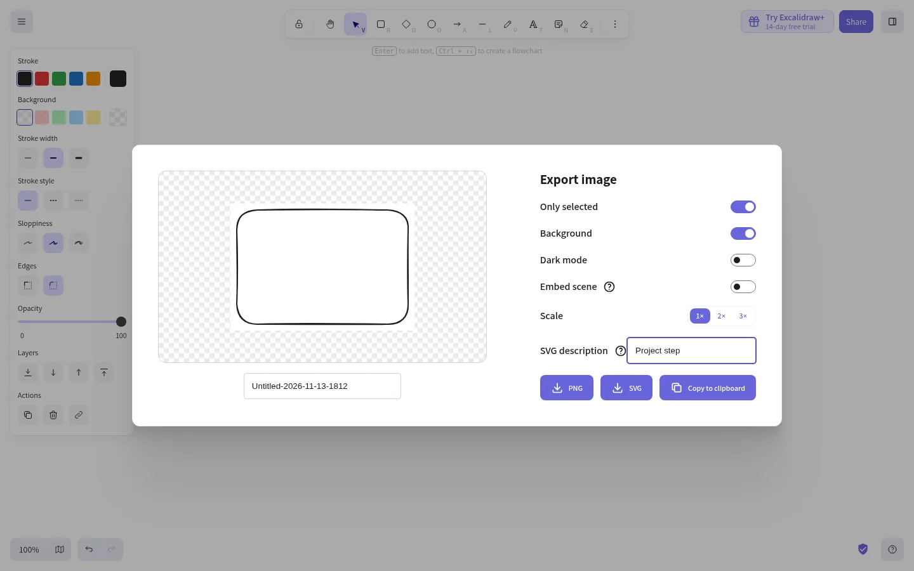

# Minha contribuição: descrição acessível na exportação SVG

**PR:** https://github.com/excalidraw/excalidraw/pull/12616



## O que a mudança faz

A janela **Export image** agora tem um campo **SVG description**. Ao preencher esse campo e clicar em **SVG**, o arquivo baixado ganha uma tag `<desc>` com o texto informado. A tag pode ser usada por ferramentas de acessibilidade. Ela não aparece visualmente no desenho. O campo vazio não adiciona uma descrição.

Por exemplo, ao digitar `Project step`, o arquivo SVG gerado contém:

```xml
<desc>Project step</desc>
```

## Onde está o código

- `packages/excalidraw/components/ImageExportDialog.tsx`: mostra o campo e lê o texto digitado.
- `packages/excalidraw/components/App.tsx` e `packages/excalidraw/data/index.ts`: levam o texto do diálogo até a exportação.
- `packages/excalidraw/scene/export.ts`: cria a tag `<desc>` na raiz do SVG, usando `textContent` para escapar caracteres especiais.
- `packages/excalidraw/tests/scene/export.test.ts` e `packages/excalidraw/tests/export.test.tsx`: cobrem o metadado e a passagem da configuração.

## Como testar localmente

É necessário ter Node.js (versão 18 ou superior) e Yarn. Em um terminal:

```bash
git clone https://github.com/DaviMattoso/excalidraw.git
cd excalidraw
git switch feat/svg-export-description
yarn install --frozen-lockfile
yarn start
```

Abra o endereço local mostrado no terminal. No Excalidraw:

1. Desenhe uma forma.
2. Abra o menu no canto superior esquerdo e escolha **Export image** (ou **Exportar imagem**).
3. Preencha **SVG description** (ou **Descrição do SVG**).
4. Clique em **SVG** e abra o arquivo baixado em um editor de texto.
5. Procure por `<desc>` perto do começo do arquivo.

Se o comando `yarn` não estiver disponível, use `corepack yarn` nos dois comandos Yarn. O PR ainda precisa de revisão dos mantenedores antes de entrar no Excalidraw oficial.
